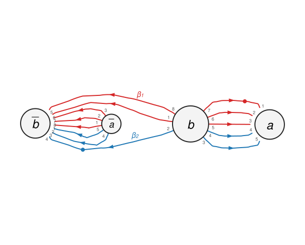

This repository contains code that checks whether the presentation complex of a balanced group presentation is the spine of a closed orientable connected 3-manifold, using Neuwirth's algorithm, and that draws the corresponding Heegaard diagram.

REQUIREMENTS:

Python 3.9 or newer and nothing else: the permutation and orbit routines that used to come from SageMath are provided by `permutation.py`, which reproduces the behaviour of the SageMath/GAP functions the algorithm relies on. The project is managed with [uv](https://docs.astral.sh/uv/); `uv run` creates the virtual environment (`.venv/`) on first use.

HOW TO USE:

Option 1 (command line): write the relators as words in the generators, where a capital letter is the inverse of the lowercase generator (`A` = $a^{-1}$). The generators are the letters that occur, in alphabetical order, so for $\langle a, b \mid b^{-2}a, a^{-1}b\rangle$ run

    uv run check.py BBa Ab

which prints the verdict together with the permutations $A$, $B$, $C$ and the reordering of the sheets that witness the spine. The exit status is 0 if $K_P$ is a spine, 1 if it is not and 2 for bad input, so the command can be used in scripts. `uv run check.py --help` lists the options; `-g abc` fixes the generators explicitly and `-q` prints only the verdict. (A relator that is not balanced with the generators, or a generator that occurs in no relator, is rejected: Neuwirth's algorithm needs every generator to occur.)

Option 2 (Python): `check_presentation([['a','A'],['b','B']],['BBa', 'Ab'])` from `neuwirthcheck.py` is the function behind the command line (`neuwirthcheck.main()` runs the trivialisation sequence of the paper); `find_2_spine(A, B, C)` returns the witnessing configuration instead of printing it.

Option 3 (Jupyter notebook): run `copy_paste_to_nb()` in `neuwirth.py` with the same input as `check_presentation()` would receive, paste the result into the indicated code cell of `neuwirthsalgorithm.ipynb` and execute the notebook with a Python 3 kernel started in this directory (for example `uv run --with jupyter jupyter lab`).

HEEGAARD DIAGRAMS:

    uv run check.py BBa Ab --heegaard

draws the Heegaard diagram given by the configuration that Neuwirth's algorithm found and opens it in the browser (the page is written to `heegaard-BBa-Ab.html` in the current directory; `--no-open` skips the browser, `--html`, `--svg` and `--tikz FILE` write the diagram as a web page, an SVG image or a TikZ picture for LaTeX, which needs `\usetikzlibrary{arrows.meta, decorations.markings}`).

The diagram is drawn on the genus $g$ surface itself: the handlebody is a ball with $g$ handles, one per generator, and the surface is its boundary. The curve $\alpha_a$ is the belt sphere of the handle of the generator $a$, drawn around the middle of the tube (dashed where it runs behind the tube). The coloured curves are the $\beta$-curves, one per relator, read in the direction of the arrows: every letter of the relator is a passage over the handle of that generator, crossing its belt circle once, and the dot marks the basepoint on the arc between the last and the first letter. Cutting the surface along the $\beta$-curves leaves it connected, which is exactly what Neuwirth's algorithm verified. Hidden parts are dashed. A strand over a handle may wind around the tube: the two ends of the handle are the two sides of the cut along $\alpha_a$, and the positions at which the curve arrives there are forced by the diagram.

The page also shows the same diagram cut open along the $\alpha$-curves, which is a sphere with $2g$ disks removed: the disks $a$ and $\bar a$ are the two feet of the handle of $a$, their boundary circles are identified so that the points with the same number coincide (these are the sheets of the generator, the points of the set $E$ on which $A$, $B$ and $C$ act), entering the disk $a$ and leaving from $\bar a$ reads the letter $a$. `--planar` makes `--svg` and `--tikz` export this view instead. When the group generated by $A$ and $C$ has $L > 1$ orbits, the ball is really $L$ balls joined by tubes in the regions that the algorithm chose (starred in the planar view).

The layout is computed from the combinatorial data alone: a Tutte embedding of the map followed by a force-directed relaxation that never changes the combinatorial embedding, so the picture is always a correct diagram; it takes a few seconds for the presentations of the paper. (The known issue that only one permutation $F$ is tried in the case $L > 1$ is unchanged; the diagram shows the regions that this $F$ joins.)

TESTS:

    uv run python -m unittest

runs the tests (about ten seconds; `NEUWIRTH_SLOW_TESTS=1` adds the presentations whose search space has millions of configurations, about ten minutes). `test_permutation.py` checks `permutation.py` against the documented SageMath behaviour and the verdicts of the paper's trivialisation sequence, `test_check.py` the command line and the Heegaard diagrams (planarity, rotation system, Euler characteristic).
